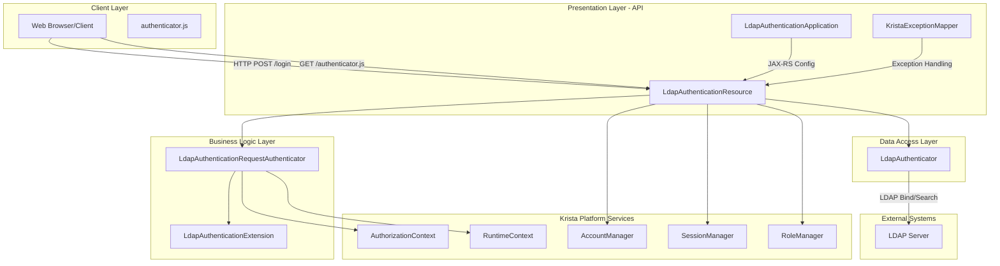
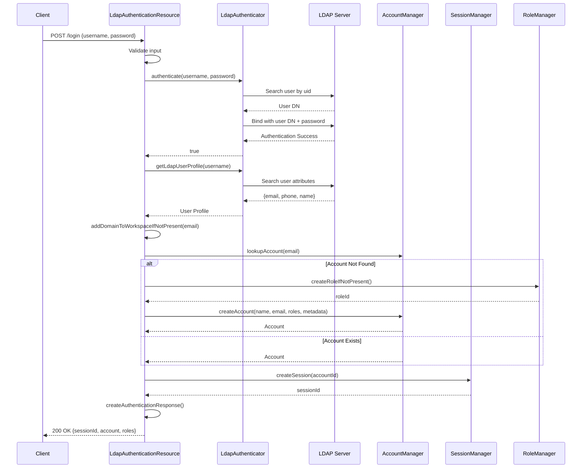
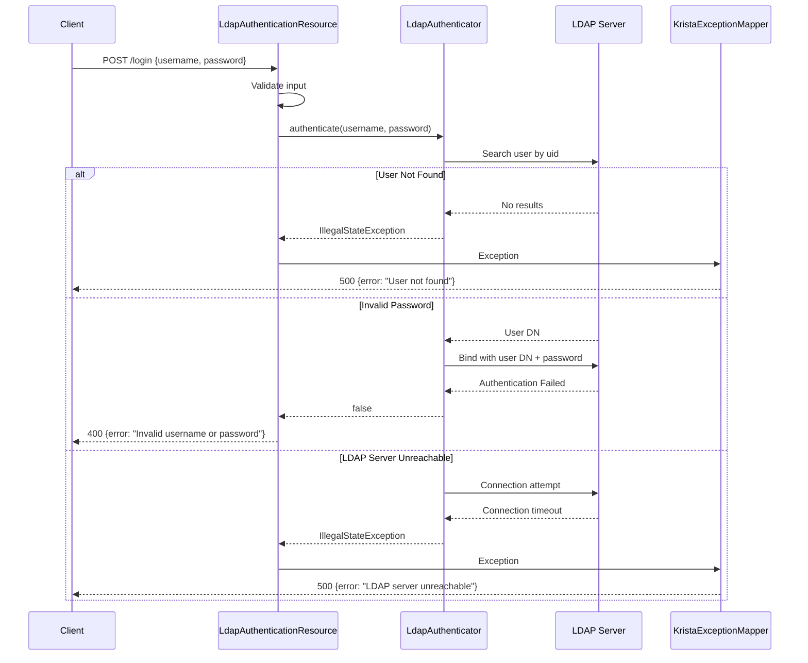
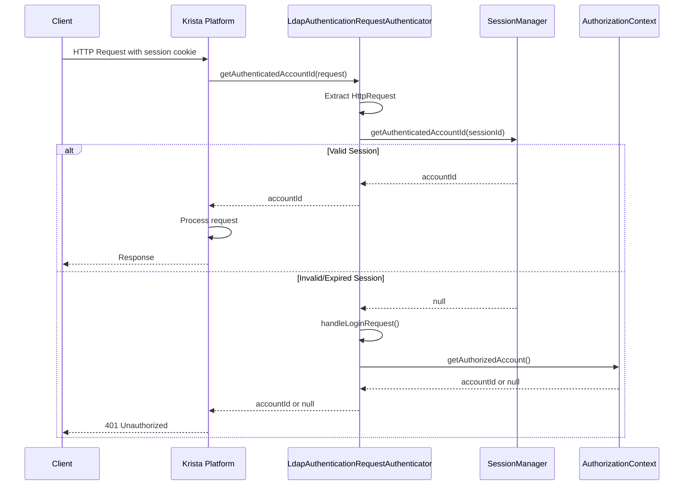
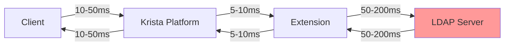
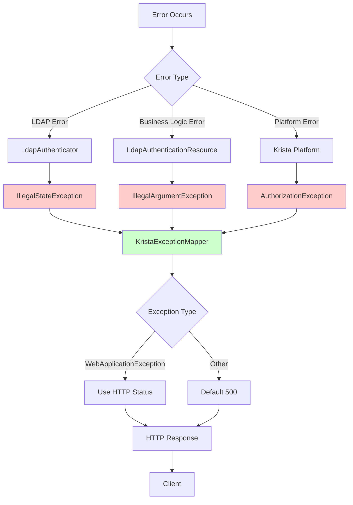
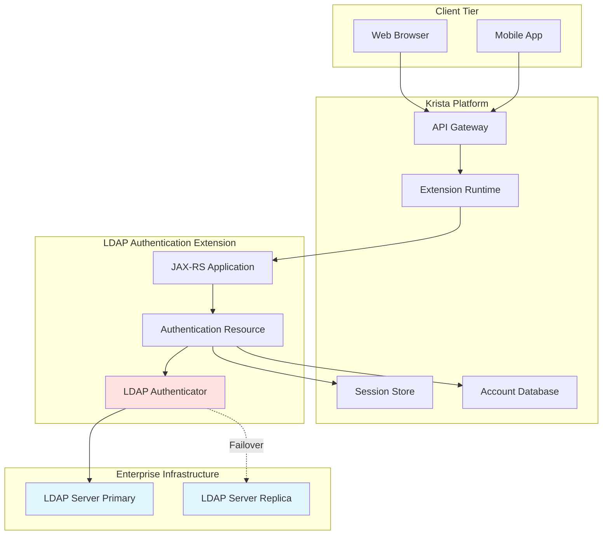

# LDAP Authentication Extension - Architecture Documentation

## Table of Contents
1. [Overview](#overview)
2. [Architecture Layers](#architecture-layers)
3. [Component Diagram](#component-diagram)
4. [Sequence Diagrams](#sequence-diagrams)
5. [Data Flow](#data-flow)
6. [Performance Considerations](#performance-considerations)
7. [Error Scenarios](#error-scenarios)
8. [Security Considerations](#security-considerations)
9. [Configuration](#configuration)

---

## Overview

The LDAP Authentication Extension provides enterprise-grade authentication capabilities for Krista applications using the Lightweight Directory Access Protocol (LDAP). It enables organizations to leverage their existing LDAP/Active Directory infrastructure for user authentication and account management.

**Package**: `app.krista.extensions.krista.authentication.ldap_authentication`  
**Extension ID**: `authn`  
**Java Version**: 21  
**Protocol**: LDAP Simple Authentication

---

## Architecture Layers

The extension follows a **layered architecture** pattern with clear separation of concerns:

### 1. **Presentation Layer (API Layer)**
**Package**: `app.krista.extensions.krista.authentication.ldap_authentication.api`

#### Components:
- **LdapAuthenticationApplication** - JAX-RS Application configuration
- **LdapAuthenticationResource** - REST API endpoints
- **KristaExceptionMapper** - Global exception handling

#### Responsibilities:
- HTTP request/response handling
- CORS configuration
- Input validation
- Response formatting
- Exception mapping to HTTP status codes

#### Endpoints:
```
GET  /authenticator.js       - Returns client-side authenticator script
GET  /docs                   - Returns HTML documentation
POST /login                  - Authenticates user credentials
OPTIONS /login               - CORS preflight handling
```

---

### 2. **Business Logic Layer (Service Layer)**
**Package**: `app.krista.extensions.krista.authentication.ldap_authentication`

#### Components:
- **LdapAuthenticationExtension** - Extension entry point and configuration
- **LdapAuthenticationRequestAuthenticator** - Request authentication orchestrator

#### Responsibilities:
- Session management
- Account lookup and creation
- Role assignment
- Domain validation
- Authentication workflow orchestration
- Integration with Krista platform services

#### Key Services Used:
- `SessionManager` - Session lifecycle management
- `AccountManager` - User account operations
- `RoleManager` - Role and permission management
- `AuthorizationContext` - Security context
- `RuntimeContext` - Platform runtime information

---

### 3. **Data Access Layer (Integration Layer)**
**Package**: `app.krista.extensions.krista.authentication.ldap_authentication.impl`

#### Components:
- **LdapAuthenticator** - LDAP protocol implementation

#### Responsibilities:
- LDAP server connectivity
- User authentication via LDAP bind
- User profile retrieval
- LDAP search operations
- Connection management

#### LDAP Operations:
```java
authenticate(ldapUrl, baseDN, bindDN, bindPass, username, password)
getLdapUserProfile(ldapUrl, baseDN, bindDN, bindPass, username, emailProperty, phoneProperty)
getLdapUserNameInNameSpace(ldapUrl, baseDN, bindDN, bindPass, username)
```

---

### 4. **Common/Utility Layer**
**Package**: `app.krista.extension.common` (from base-authentication)

#### Components:
- **CommonUtils** - Utility functions (email validation, domain management)
- **ClientSessionUtil** - Session utilities
- **AuthenticationResponse** - Response DTOs
- **KristaError** - Error response models

---

## Component Diagram



---


## Sequence Diagrams

### Authentication Flow - Successful Login



### Authentication Flow - Failed Login




### Request Authentication Flow



---

## Data Flow

### 1. Login Request Data Flow

```
Client Input
    ↓
{username, password}
    ↓
LdapAuthenticationResource.login()
    ↓
Input Validation
    ↓
LdapAuthenticator.authenticate()
    ↓
LDAP Server (Bind Operation)
    ↓
Authentication Result (true/false)
    ↓
LdapAuthenticator.getLdapUserProfile()
    ↓
LDAP Server (Search Operation)
    ↓
User Profile {email, phone, name, NameInNamespace}
    ↓
Domain Validation
    ↓
AccountManager.lookupAccount(email)
    ↓
Account Creation (if not exists)
    ↓
SessionManager.createSession(accountId)
    ↓
AuthenticationResponse {sessionId, account, roles}
    ↓
Client Response (JSON)
```

### 2. Configuration Data Flow

```
Extension Configuration (Invoker Attributes)
    ↓
┌─────────────────────────────────────┐
│ LDAP_SERVER_URL                     │
│ BASE_DN                             │
│ BIND_DN                             │
│ BIND_DN_PASSWORD (Secured)          │
│ DEFAULT_ROLE                        │
│ MAPPED_EMAIL_PROPERTY               │
│ MAPPED_PHONE_PROPERTY               │
└─────────────────────────────────────┘
    ↓
Runtime Access via Invoker.getAttributes()
    ↓
LdapAuthenticator Operations
```

---

## Performance Considerations

### 1. **LDAP Connection Management**

#### Current Implementation:
- **Connection Pattern**: Create new connection per operation
- **Resource Management**: Connections closed in `finally` blocks
- **No Connection Pooling**: Each authentication creates 2-3 new LDAP connections

#### Performance Impact:
| Operation | LDAP Connections | Estimated Latency |
|-----------|------------------|-------------------|
| User Search | 1 | 50-200ms |
| User Authentication | 1 | 50-200ms |
| Profile Retrieval | 1 | 50-200ms |
| **Total per Login** | **3** | **150-600ms** |

#### Bottlenecks:
```
🔴 HIGH IMPACT
- No connection pooling → High connection overhead
- Synchronous LDAP operations → Blocking I/O
- Multiple round trips to LDAP server per login

🟡 MEDIUM IMPACT
- No caching of user profiles
- No caching of LDAP search results
- Full subtree search on every authentication
```

#### Recommendations:
```java
// 🟢 RECOMMENDED: Implement connection pooling
LdapConnectionPool pool = new LdapConnectionPool(
    connectionFactory, 
    initialSize: 5, 
    maxSize: 20
);

// 🟢 RECOMMENDED: Cache user DN lookups
Cache<String, String> userDnCache = CacheBuilder.newBuilder()
    .expireAfterWrite(15, TimeUnit.MINUTES)
    .maximumSize(1000)
    .build();

// 🟢 RECOMMENDED: Combine operations
// Instead of: search → bind → search profile
// Do: search with all attributes → bind
```

---

### 2. **Session Management**

#### Current Implementation:
- Session creation on every successful login
- No session timeout configuration visible
- Session lookup on every authenticated request

#### Performance Characteristics:
- **Session Creation**: O(1) - Fast
- **Session Lookup**: O(1) - Fast (assuming hash-based storage)
- **Session Validation**: Per-request overhead

---

### 3. **Account Management**

#### Current Implementation:
```java
Account account = accountManager.lookupAccount(email);
if (account == null) {
    account = accountManager.createAccount(...);
}
```

#### Performance Impact:
- **First-time users**: 2 database operations (lookup + create)
- **Returning users**: 1 database operation (lookup)
- **Role creation**: Additional database queries if role doesn't exist

#### Optimization Opportunities:
- Cache account lookups for active sessions
- Batch role creation during system initialization
- Use database indexes on email field

---

### 4. **Scalability Limits**

#### Concurrent User Limits:
```
Assumptions:
- LDAP server: 1000 concurrent connections max
- Average login time: 400ms
- No connection pooling

Theoretical Max Throughput:
= 1000 connections / 0.4 seconds
= 2,500 logins/second

Realistic Throughput (with overhead):
= ~500-1000 logins/second
```

#### Memory Footprint:
```
Per Login Request:
- HttpRequest object: ~2-5 KB
- LDAP connection: ~10-20 KB
- Account object: ~1-2 KB
- Session object: ~1 KB
Total: ~15-30 KB per concurrent login

For 1000 concurrent logins:
= 15-30 MB memory
```

---

### 5. **Network Latency**

#### Latency Breakdown:


**Critical Path**: LDAP Server latency (50-200ms per operation)

#### Mitigation Strategies:
1. **Deploy LDAP replica closer to application** - Reduce network latency
2. **Use LDAP connection pooling** - Reduce connection establishment overhead
3. **Implement caching** - Reduce LDAP queries for frequently accessed data
4. **Async authentication** - Non-blocking I/O for LDAP operations

---

## Error Scenarios

### Error Handling Architecture



---

### 1. **LDAP Connection Errors**

#### Scenario: LDAP Server Unreachable
```java
// Error Location: LdapAuthenticator.getSearchResult()
context = new InitialDirContext(getAdminAuthProperties(ldapUrl, bindDN, bindPass));
```

**Error Symptoms:**
- `javax.naming.CommunicationException`
- `javax.naming.ServiceUnavailableException`
- Connection timeout

**Error Response:**
```json
{
  "message": "Error during getting ldap user. Connection refused",
  "code": "Open Ldap Auth - 500"
}
```

**HTTP Status**: 500 Internal Server Error

**Root Causes:**
- LDAP server down
- Network connectivity issues
- Firewall blocking LDAP port (389/636)
- Incorrect LDAP URL configuration

**Mitigation:**
```java
// 🟢 RECOMMENDED: Add retry logic with exponential backoff
int maxRetries = 3;
for (int i = 0; i < maxRetries; i++) {
    try {
        context = new InitialDirContext(props);
        break;
    } catch (CommunicationException e) {
        if (i == maxRetries - 1) throw e;
        Thread.sleep((long) Math.pow(2, i) * 1000);
    }
}

// 🟢 RECOMMENDED: Health check endpoint
@GET
@Path("/health")
public Response healthCheck() {
    boolean ldapReachable = checkLdapConnection();
    return ldapReachable ? Response.ok().build() : Response.status(503).build();
}
```

---

### 2. **Authentication Failures**

#### Scenario A: Invalid Credentials
```java
// Error Location: LdapAuthenticator.authenticate()
initialDirContext = new InitialDirContext(props); // Throws NamingException
```

**Error Response:**
```json
{
  "message": "Invalid username or password.",
  "code": "Open Ldap Auth - 500"
}
```

**HTTP Status**: 400 Bad Request (should be 401 Unauthorized)

**Root Causes:**
- Wrong password
- Account locked in LDAP
- Password expired

#### Scenario B: User Not Found
```java
// Error Location: LdapAuthenticator.getSearchResult()
if (!answers.hasMore()) {
    throw new IllegalStateException("User with username " + username + "' not found.");
}
```

**Error Response:**
```json
{
  "message": "User with username 'john.doe' not found.",
  "code": "Open Ldap Auth - 500"
}
```

**HTTP Status**: 500 Internal Server Error (should be 404 Not Found)

**Root Causes:**
- User doesn't exist in LDAP
- Incorrect BASE_DN configuration
- User outside search scope
- Incorrect uid attribute mapping

---

### 3. **Configuration Errors**

#### Scenario: Missing Required Configuration
```java
String ldapUrl = (String) invoker.getAttributes().get(LdapAuthenticationExtension.URL);
// ldapUrl is null
```

**Error Response:**
```json
{
  "message": "NullPointerException",
  "code": "Open Ldap Auth - 500"
}
```

**HTTP Status**: 500 Internal Server Error

**Root Causes:**
- Extension not configured properly
- Missing required fields: URL, BASE_DN, BIND_DN, BIND_DN_PASSWORD

**Mitigation:**
```java
// 🟢 RECOMMENDED: Validate configuration on startup
@PostConstruct
public void validateConfiguration() {
    Objects.requireNonNull(invoker.getAttributes().get(URL), "LDAP_SERVER_URL is required");
    Objects.requireNonNull(invoker.getAttributes().get(BASE_DN), "BASE_DN is required");
    Objects.requireNonNull(invoker.getAttributes().get(BIND_DN), "BIND_DN is required");
    Objects.requireNonNull(invoker.getAttributes().get(BIND_DN_PASSWORD), "BIND_DN_PASSWORD is required");
}
```

---

### 4. **User Profile Errors**

#### Scenario: Missing Email Attribute
```java
// Error Location: LdapAuthenticator.getLdapUserProfile()
Attribute emailAttribute = result.getAttributes().get(emailProperty);
if (emailAttribute == null) {
    throw new IllegalStateException("Email address not found for username '" + username + "'");
}
```

**Error Response:**
```json
{
  "message": "Email address not found for username 'john.doe'",
  "code": "Open Ldap Auth - 500"
}
```

**HTTP Status**: 500 Internal Server Error

**Root Causes:**
- User entry missing email attribute
- Incorrect email property mapping (default: "mail")
- LDAP schema doesn't include email field

**Mitigation:**
```java
// 🟢 RECOMMENDED: Provide fallback or use username as email
String email = emailAttribute != null 
    ? (String) emailAttribute.get() 
    : username + "@" + defaultDomain;
```

---

### 5. **Domain Validation Errors**

#### Scenario: Unsupported Email Domain
```java
// Error Location: LdapAuthenticationResource.addDomainToWorkspaceIfNotPresent()
CommonUtils.validateIfSupportedDomain(email, supportedDomain, invokerDomains);
```

**Error Response:**
```json
{
  "message": "Domain 'external.com' is not supported",
  "code": "Open Ldap Auth - 500"
}
```

**HTTP Status**: 403 Forbidden

**Root Causes:**
- User's email domain not in workspace's supported domains list
- Strict domain validation enabled

---

### 6. **Session Management Errors**

#### Scenario: Session Creation Failure
```java
// Error Location: LdapAuthenticationResource.login()
String sessionId = sessionManager.createSession(account.getAccountId());
```

**Potential Errors:**
- Session storage full
- Database connection failure
- Account ID invalid

**HTTP Status**: 500 Internal Server Error

---

### 7. **Account Creation Errors**

#### Scenario: Duplicate Account
```java
// Error Location: LdapAuthenticationResource.getAccount()
account = accountManager.createAccount(name, email, roles, metadata);
```

**Potential Errors:**
- Email already exists (race condition)
- Invalid role ID
- Database constraint violation

**HTTP Status**: 500 Internal Server Error

---

### Error Summary Table

| Error Category | HTTP Status | Current | Recommended | Severity |
|----------------|-------------|---------|-------------|----------|
| LDAP Unreachable | 500 | ✅ | 503 Service Unavailable | 🔴 Critical |
| Invalid Credentials | 400 | ⚠️ | 401 Unauthorized | 🟡 High |
| User Not Found | 500 | ❌ | 404 Not Found | 🟡 High |
| Missing Config | 500 | ❌ | 500 + Startup Validation | 🔴 Critical |
| Missing Email | 500 | ⚠️ | 422 Unprocessable Entity | 🟡 High |
| Domain Not Allowed | 403 | ✅ | 403 Forbidden | 🟢 Medium |
| Session Failure | 500 | ✅ | 500 Internal Server Error | 🔴 Critical |

---

## Security Considerations

### 1. **Credential Management**

#### Current Implementation:
```java
@Field(name = BIND_DN_PASSWORD, type = "Text", 
       attributes = @Attribute(name = "isSecured", value = "true"))
```

**Security Features:**
- ✅ BIND_DN_PASSWORD marked as secured field
- ✅ Credentials not logged (except in stack traces)
- ❌ No encryption in transit validation
- ❌ No credential rotation mechanism

#### Recommendations:
```java
// 🔴 CRITICAL: Use LDAPS (LDAP over SSL/TLS)
String ldapUrl = "ldaps://ldap.example.com:636"; // Not ldap://

// 🔴 CRITICAL: Validate SSL certificates
props.put("java.naming.ldap.factory.socket", "javax.net.ssl.SSLSocketFactory");

// 🟡 RECOMMENDED: Use environment variables or secret management
String bindPassword = System.getenv("LDAP_BIND_PASSWORD");
```

---

### 2. **LDAP Injection Prevention**

#### Vulnerability: LDAP Injection
```java
// ⚠️ VULNERABLE CODE
context.search(baseDN, "(uid=" + username + ")", getSearchControls());
```

**Attack Example:**
```
username = "admin)(|(uid=*"
Resulting filter: (uid=admin)(|(uid=*))
// This bypasses authentication!
```

#### Mitigation:
```java
// 🟢 RECOMMENDED: Sanitize input
private String escapeLdapSearchFilter(String input) {
    return input.replace("\\", "\\\\")
                .replace("*", "\\*")
                .replace("(", "\\(")
                .replace(")", "\\)")
                .replace("\0", "\\00");
}

// Usage:
String safeUsername = escapeLdapSearchFilter(username);
context.search(baseDN, "(uid=" + safeUsername + ")", getSearchControls());
```

---

### 3. **Password Handling**

#### Current Implementation:
```java
// ⚠️ Password in plain text in memory
String password = loginInput.get("password");
```

**Security Concerns:**
- Passwords stored in String (immutable, remains in memory)
- No password complexity validation
- Passwords printed in exception stack traces

#### Recommendations:
```java
// 🟢 RECOMMENDED: Use char[] instead of String
char[] password = loginInput.get("password").toCharArray();
try {
    // Use password
} finally {
    Arrays.fill(password, '\0'); // Clear password from memory
}

// 🟡 RECOMMENDED: Validate password complexity
private void validatePasswordComplexity(String password) {
    if (password.length() < 8) {
        throw new IllegalArgumentException("Password must be at least 8 characters");
    }
    // Add more complexity rules
}
```

---

### 4. **Session Security**

#### Current Implementation:
- Session ID generated by SessionManager
- No visible session timeout configuration
- No session fixation protection

#### Recommendations:
```java
// 🟢 RECOMMENDED: Implement session timeout
sessionManager.createSession(accountId, Duration.ofHours(8));

// 🟢 RECOMMENDED: Regenerate session ID after login
String oldSessionId = request.getSessionId();
String newSessionId = sessionManager.regenerateSession(oldSessionId);

// 🟡 RECOMMENDED: Implement concurrent session control
sessionManager.invalidateOtherSessions(accountId, currentSessionId);
```

---

### 5. **CORS Configuration**

#### Current Implementation:
```java
.header("Access-Control-Allow-Origin", "*")
.header("Access-Control-Allow-Methods", "POST, GET, OPTIONS")
.header("Access-Control-Allow-Headers", "Content-Type")
```

**Security Risk:**
- ⚠️ Allows requests from ANY origin (`*`)
- ⚠️ No credentials support
- ⚠️ Potential CSRF vulnerability

#### Recommendations:
```java
// 🔴 CRITICAL: Restrict CORS to specific origins
private static final List<String> ALLOWED_ORIGINS = List.of(
    "https://app.krista.com",
    "https://admin.krista.com"
);

private Response.ResponseBuilder getResponseBuilderWithCORSHeaders(String origin) {
    if (ALLOWED_ORIGINS.contains(origin)) {
        return Response.status(200)
            .header("Access-Control-Allow-Origin", origin)
            .header("Access-Control-Allow-Credentials", "true")
            .header("Access-Control-Allow-Methods", "POST, GET, OPTIONS")
            .header("Access-Control-Allow-Headers", "Content-Type, Authorization");
    }
    return Response.status(403);
}
```

---

### 6. **Error Information Disclosure**

#### Current Implementation:
```java
exception.printStackTrace(); // Logs full stack trace
return Response.status(statusCode).entity(new KristaError(message, "Open Ldap Auth - 500")).build();
```

**Security Risk:**
- ⚠️ Stack traces may expose sensitive information
- ⚠️ Error messages may reveal system details

#### Recommendations:
```java
// 🟢 RECOMMENDED: Log detailed errors, return generic messages
logger.error("Authentication failed for user: {}", username, exception);
return Response.status(401).entity(new KristaError("Authentication failed", "AUTH_001")).build();
```

---

### 7. **Rate Limiting**

#### Current Implementation:
- ❌ No rate limiting
- ❌ No brute force protection
- ❌ No account lockout mechanism

#### Recommendations:
```java
// 🔴 CRITICAL: Implement rate limiting
@RateLimited(maxAttempts = 5, windowSeconds = 300)
@POST
@Path("/login")
public Response login(...) {
    // Login logic
}

// 🔴 CRITICAL: Implement account lockout
private void checkAccountLockout(String username) {
    int failedAttempts = loginAttemptService.getFailedAttempts(username);
    if (failedAttempts >= 5) {
        long lockoutTime = loginAttemptService.getLockoutTime(username);
        if (System.currentTimeMillis() < lockoutTime) {
            throw new AccountLockedException("Account locked due to multiple failed attempts");
        }
    }
}
```

---

### 8. **Audit Logging**

#### Current Implementation:
```java
System.out.println("Authorization Context: " + authorizationContext.getAuthorizedAccount().getAccountId());
```

**Security Concerns:**
- ⚠️ Using System.out instead of proper logging
- ⚠️ No audit trail for authentication events
- ⚠️ No logging of failed login attempts

#### Recommendations:
```java
// 🟢 RECOMMENDED: Comprehensive audit logging
private void auditLoginAttempt(String username, String ipAddress, boolean success) {
    AuditEvent event = AuditEvent.builder()
        .eventType(success ? "LOGIN_SUCCESS" : "LOGIN_FAILURE")
        .username(username)
        .ipAddress(ipAddress)
        .timestamp(Instant.now())
        .userAgent(getUserAgent())
        .build();
    auditLogger.log(event);
}
```

---

### Security Checklist

| Security Control | Status | Priority | Recommendation |
|------------------|--------|----------|----------------|
| LDAPS (SSL/TLS) | ❌ | 🔴 Critical | Enforce LDAPS for all connections |
| LDAP Injection Prevention | ❌ | 🔴 Critical | Sanitize all user inputs |
| Password Complexity | ❌ | 🟡 High | Implement password policy |
| Rate Limiting | ❌ | 🔴 Critical | Add rate limiting to /login |
| Account Lockout | ❌ | 🔴 Critical | Lock accounts after failed attempts |
| CORS Restriction | ❌ | 🔴 Critical | Restrict to specific origins |
| Session Timeout | ⚠️ | 🟡 High | Configure explicit timeout |
| Audit Logging | ⚠️ | 🟡 High | Implement comprehensive logging |
| Error Sanitization | ⚠️ | 🟡 High | Avoid information disclosure |
| Credential Rotation | ❌ | 🟢 Medium | Support credential rotation |

---

## Configuration

### Extension Configuration Fields

| Field Name | Type | Required | Secured | Default | Description |
|------------|------|----------|---------|---------|-------------|
| `LDAP_SERVER_URL` | Text | ✅ Yes | ❌ No | - | LDAP server URL (e.g., ldap://ldap.example.com:389) |
| `BASE_DN` | Text | ✅ Yes | ❌ No | - | Base Distinguished Name for LDAP searches |
| `BIND_DN` | Text | ✅ Yes | ❌ No | - | Admin bind DN for LDAP authentication |
| `BIND_DN_PASSWORD` | Text | ✅ Yes | ✅ Yes | - | Password for bind DN |
| `DEFAULT_ROLE` | Text | ❌ No | ❌ No | "Krista Client User" | Default role assigned to LDAP users |
| `MAPPED_EMAIL_PROPERTY` | Text | ❌ No | ❌ No | "mail" | LDAP attribute for email address |
| `MAPPED_PHONE_PROPERTY` | Text | ❌ No | ❌ No | "telephoneNumber" | LDAP attribute for phone number |

### Configuration Example

```json
{
  "LDAP_SERVER_URL": "ldap://ldap.company.com:389",
  "BASE_DN": "dc=company,dc=com",
  "BIND_DN": "cn=admin,dc=company,dc=com",
  "BIND_DN_PASSWORD": "********",
  "DEFAULT_ROLE": "LDAP User",
  "MAPPED_EMAIL_PROPERTY": "mail",
  "MAPPED_PHONE_PROPERTY": "telephoneNumber"
}
```

### LDAP Search Configuration

**Search Filter**: `(uid={username})`  
**Search Scope**: `SUBTREE_SCOPE`  
**Returned Attributes**: `givenName`, `cn`, `sn`, `memberOf`, `mail`, `telephoneNumber`

---

## Deployment Architecture



---

## Technology Stack

| Layer | Technology | Version |
|-------|------------|---------|
| **Language** | Java | 21 |
| **Framework** | JAX-RS | 2.x |
| **DI Container** | HK2 | 2.x |
| **LDAP Client** | JNDI | Built-in |
| **JSON Processing** | Gson | Via Krista SDK |
| **Build Tool** | Gradle | 8.5 |

---

## Dependencies

### Compile Dependencies
- `app.krista:extension-api`
- `app.krista:krista-sdk`
- `project(':base-authentication')`
- `javax.ws.rs:javax.ws.rs-api:2.1.1`
- `org.glassfish.hk2:hk2-api:2.6.1`

### Runtime Dependencies
- Java Naming and Directory Interface (JNDI)
- LDAP Context Factory

---

## Key Metrics & SLAs

### Performance Targets
- **Login Response Time**: < 1 second (p95)
- **Authentication Success Rate**: > 99.9%
- **LDAP Connection Timeout**: 5 seconds
- **Session Creation Time**: < 100ms

### Availability
- **Target Uptime**: 99.9%
- **Dependency**: LDAP server availability
- **Failover**: Manual configuration to replica

---

## Limitations

### Current Limitations

1. **No Connection Pooling** - Creates new LDAP connection per operation
2. **No Caching** - User profiles fetched on every login
3. **Synchronous Operations** - Blocking I/O for LDAP calls
4. **No Retry Logic** - Single attempt for LDAP operations
5. **No Health Checks** - No endpoint to verify LDAP connectivity
6. **No Metrics** - No performance monitoring or metrics collection
7. **No Role Mapping** - LDAP groups not mapped to Krista roles
8. **Simple Authentication Only** - No support for SASL or other auth methods
9. **No Multi-Factor Authentication** - Single-factor authentication only
10. **No Password Policy Enforcement** - Relies on LDAP server policies

### Scale Limitations

- **Max Concurrent Logins**: ~500-1000/second (LDAP server dependent)
- **Max Active Sessions**: Limited by SessionManager implementation
- **LDAP Server Load**: 3 operations per login

---

## Future Enhancements

### High Priority
- ✅ Implement LDAP connection pooling
- ✅ Add rate limiting and brute force protection
- ✅ Enforce LDAPS (SSL/TLS)
- ✅ Implement LDAP injection prevention
- ✅ Add comprehensive audit logging

### Medium Priority
- ⚠️ Cache user DN lookups
- ⚠️ Add health check endpoint
- ⚠️ Implement retry logic with exponential backoff
- ⚠️ Map LDAP groups to Krista roles
- ⚠️ Add metrics and monitoring

### Low Priority
- 🔵 Support SASL authentication
- 🔵 Implement MFA support
- 🔵 Add password policy enforcement
- 🔵 Support multiple LDAP servers with load balancing

---

## Glossary

| Term | Definition |
|------|------------|
| **LDAP** | Lightweight Directory Access Protocol - Protocol for accessing directory services |
| **DN** | Distinguished Name - Unique identifier for an entry in LDAP |
| **Bind DN** | Admin account used to authenticate to LDAP server |
| **Base DN** | Starting point for LDAP searches |
| **uid** | User identifier attribute in LDAP |
| **LDAPS** | LDAP over SSL/TLS (secure LDAP) |
| **JNDI** | Java Naming and Directory Interface |
| **JAX-RS** | Java API for RESTful Web Services |
| **HK2** | Dependency injection framework |

---

## References

- [LDAP RFC 4511](https://tools.ietf.org/html/rfc4511)
- [JNDI LDAP Documentation](https://docs.oracle.com/javase/jndi/tutorial/ldap/)
- [Krista Extension API Documentation](https://docs.krista.com/extensions)

---

**Document Version**: 1.0  
**Last Updated**: 2026-01-21  
**Author**: Architecture Team  
**Status**: ✅ Complete

